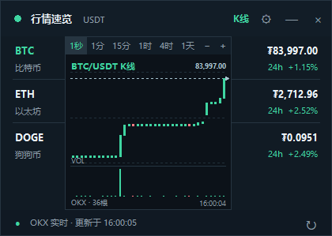
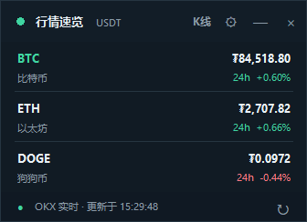

# 行情速览 MarketPeek

Windows 桌面悬浮行情看板：数字币现货、Bitget 永续、美股放在同一个窗口里，显示价格、涨跌和 K 线。窗口透明置顶、可拖动、可收进系统托盘，双击 exe 即用，不需要安装 Python。

- 版本：**V1.0.1**　作者：**LIFANGHAO**
- 平台：Windows 7 SP1 / 10 / 11（32 位与 64 位均有对应程序）




## 功能

- 数字币：默认 BTC / ETH / SOL，币安 USDT 现货报价与 24 小时涨跌，WebSocket 实时推送；断线时约 1 秒轮询保底。
- K 线：数字币支持 1 秒 / 1 分 / 15 分 / 1 小时 / 4 小时 / 1 天，先取历史再接收实时推送，未收线的一根用更快的报价临时预览、收到官方 K 线后校准。
- MSTR 永续：Bitget `MSTRUSDT`（USDT-FUTURES），美股休市也能看；明确标注永续合约，不会回退成正股报价。
- 美股：STRC 走 Yahoo 公开参考数据，USD 计价，含盘前 / 盘中 / 盘后状态与数据时间。
- 交互：窗口任意位置拖动、滚轮或 `+/−` 缩放 K 线根数、`VOL` 切换量能柱、`K线` 收起图表、`⚙` 调整列表与透明度、`—`/`Esc` 隐藏、`Ctrl+Alt+M` 全局显隐、托盘双击恢复。

## 运行

| 情况 | 用哪个 |
| --- | --- |
| Windows 10/11 64 位 | 根目录的 `MarketPeek.exe` |
| 不知道位数，或提示缺 `api-ms-win-core-path-l1-1-0.dll` | `MarketPeek_双版本\Win7_32位兼容版\MarketPeek_Win7_32.exe` |

兼容版旁边的 `api-ms-win-*.dll` / `ucrtbase.dll` 是微软 UCRT 运行库，必须与 exe 放在同一文件夹。Win7 还需要系统更新 KB2533623（或包含它的后续更新）。不支持 XP / Vista / macOS / 手机。

## 数据来源与 API 性质

**结论：全部使用公开行情 API，不需要任何 API key、密钥、签名或账号登录。**

代码中不存在 `api_key` / `secret` / `signature` / `Authorization` / `token` 等任何认证字段，所有请求头只有 `User-Agent` 和 `Accept`。

| 数据 | 来源 | REST / WebSocket | 凭证 |
| --- | --- | --- | --- |
| 数字币现货（默认） | 币安公开行情 | `https://data-api.binance.vision` · `wss://data-stream.binance.vision/ws` | 无 |
| 降级 1 | Gate.io | `https://api.gateio.ws/api/v4` · `wss://api.gateio.ws/ws/v4/` | 无 |
| 降级 2 | OKX | `https://www.okx.com` | 无 |
| MSTR 永续 | Bitget | `https://api.bitget.com` · `wss://ws.bitget.com/v2/ws/public` | 无 |
| STRC 美股 | Yahoo Finance | `https://query1.finance.yahoo.com` · `query2`（主备同源） | 无 |

两点区别值得注意：

- 币安用的是官方专门给公开市场数据的 `data-api.binance.vision` 域名（`api.binance.com` 的公开子集），本身就是「无需密钥」的设计。
- Yahoo 的 `/v8/finance/chart` 是**公开但非官方文档化**的接口，稳定性和字段可能随时变动，也常有延时；它不是「私密 API」，只是没有正式契约。

公开端点有频率限制，也受网络环境影响：OKX 在中国大陆通常需要代理，币安在部分网络下会降级到 Gate.io，窗口底部会显示当前实际来源。

## 配置与日志

设置在 `%APPDATA%\MarketPeek\`，出错日志也在同一目录。

## 从源码运行

```bash
python -m pip install pillow pystray websocket-client
python MarketPeek.py
```

`tkinter` 为 Python 标准库自带；源码使用 `urllib`，无额外 HTTP 依赖。开发版本为 Python 3.12，Win7 兼容版用 Python 3.8 x86 打包。

三份源码的职责：

| 文件 | 内容 |
| --- | --- |
| `MarketPeek.py` | 主程序：窗口、K 线绘制、托盘、设置、币安/Gate/OKX 行情与降级 |
| `market_perps.py` | Bitget USDT 永续（REST + WebSocket 公开频道） |
| `market_stocks.py` | Yahoo 美股报价与 K 线，含盘前盘后时段处理 |

## 目录说明

```
MarketPeek.py                主程序源码
market_perps.py              Bitget 永续行情
market_stocks.py             Yahoo 美股行情
MarketPeek.exe               已打包的 64 位单文件
MarketPeek_双版本/            发布包：64 位 + Win7 32 位兼容版 + 第三方许可
MarketPeek.zip               上述发布包的压缩版
123/                         同一发布包的重复副本（仅本地，未纳入版本库）
__pycache__/                 运行缓存（未纳入版本库）
使用说明.txt                  面向最终用户的操作说明
```

## 打包

用 PyInstaller 打成单文件 exe，分两个目标：Python 3.12 x64（主版本）与 Python 3.8 x86（Win7 兼容版，附带 UCRT 运行库）。打包结果分别放进 `MarketPeek_双版本\` 的两个子目录。

## 第三方组件

`MarketPeek_双版本\第三方许可\` 下保留了 Python、Pillow、pystray、six、websocket-client、PyInstaller、Tcl/Tk 的许可证原文，以及 UCRT 的再分发说明与 x86 运行库清单/签名文件。

## 免责声明

行情数据来自第三方公开接口，可能存在延时、限流或中断，界面已尽量标注来源与数据时间。Bitget 的 MSTR 永续价格与 MSTR 正股存在价差，不能互相替代。本项目仅用于行情查看，不构成任何投资建议。
